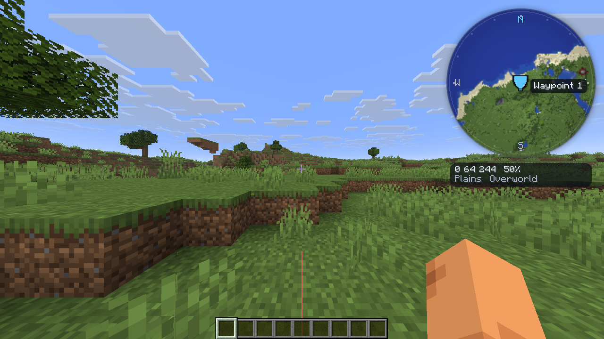

# Weaver Minimap v2

Status: implemented on `feature/minimap-v2` for Minecraft 26.3 / Java 26.
The mod lives in [`examples/minimap`](../examples/minimap) and remains
client-only.



## What changed from v1

v1 proved the loader hooks: a square HUD, a simple fullscreen screen, basic
waypoints, region storage, and settings rows. v2 is a redesign:

- True circular/rounded HUD with cached chrome, a compass ring, a player arrow,
  a readout outside the map, off-screen arrows, entity categories, and hover
  tooltips.
- A desktop-style fullscreen map with a toolbar, searchable waypoint sidebar,
  layers/cave panel, status bar, context menu, draggable waypoints, and a
  waypoint editor.
- Ten-tab settings with a live HUD preview, search, reset/import/export, colour
  and icon pickers, and keybind capture.
- Real cave slices at a chosen Y, automatic cave-level detection, transparency,
  and a dimmed surface overlay, with Overworld/Nether/End palettes.
- Waypoint v2 with icons, groups, temporary expiry, death waypoints, and JSON
  import/export; v1 files still load.
- Region storage v2 with biome palettes, async loads, LRU caches, mip data, and
  corrupt recovery.
- Six themes and a runtime-generated icon atlas.
- Public `MinimapApi` provider registries.
- General loader additions: tooltip injection, world render hook, client chunk
  events, key modifiers, and partial/mipmapped dynamic textures.

## Terrain rendering

The surface layer is drawn from the blocks themselves, not from a palette of
flat material colours:

- **Texture-derived colour.** Every block state resolves to the average colour
  of its top texture, cached per state and per texture path. Stone keeps its
  grain, planks keep their grain direction's tonal noise, and a beach is sand
  rather than a beige rectangle. Blocks without a usable model fall back to the
  vanilla map colour.
- **Biome tint.** The tint index of the top quad is resolved through the same
  `BlockTintSource` the block renderer uses, and the biome colour is sampled
  over a three-by-three cross so the seam between two biomes is a gradient
  instead of a line. Grass, foliage and water therefore keep their biome.
- **Relief.** Each column exposes a normal from the height difference to its
  north and west neighbours and is lit by a fixed north-west sun, with the
  ambient side tinted blue in the Overworld and red in the Nether. Low ground
  sits darker than high ground.
- **Daylight.** Sky light is folded into the same curve, so the map dims at
  night instead of glowing.
- **Water depth.** A water column is measured to its floor and composited over
  it with the water texture's own alpha, darkened by depth. Shallow water shows
  the sea floor, deep water is water, and the coastline gains a pale shelf.
- **No vegetation litter.** Short grass, ferns, flowers and torches are skipped
  so a meadow shows its grass block instead of a pixel of static; leaves stay
  opaque because a canopy is what the map should show.

The HUD samples the region data bilinearly and falls back to the 64x64 mip when
zoomed out, so the minimap stays continuous while walking. The fullscreen map
uses linear-filtered region textures with a per-frame upload budget.

## Feature tour

### HUD

- Circle or rounded glass, four corners plus custom offsets, 64-384 px, scale,
  opacity, border opacity, and soft shadow.
- North-up or smooth player-up rotation; smooth zoom and yaw.
- Compass ticks and cardinal letters that rotate with the map.
- Player arrow with outline, waypoint markers with icon discs and labels,
  off-screen arrows, player/entity markers with category limits.
- Coordinates, biome, dimension, zoom, and clock readout below the map.
- Hides for the debug screen, chat (configurable), other screens, and the
  temporary hide keybind.
- Hover tooltips for waypoint markers.
- Third-party HUD overlay lines through `MinimapApi`.

### Fullscreen map

- Toolbar: close, search, add waypoint, centre player, layers, settings.
- Sidebar: search, group filter, name/distance/colour sorting, waypoint cards
  with icon, distance, coordinates, group, eye, and delete actions.
- Layer panel: cave layer and cave mode, waypoints, deaths, players, entities,
  chunk grid, slime chunks, world border, spawn, transparency, and surface
  overlay.
- Canvas: pan, wheel zoom at the cursor, double-click zoom, arrow keys, Home,
  chunk grid, world border, spawn, slime chunks (single-player), cave slices,
  context menu, and drag-to-move waypoints.
- Status bar: cursor/player coordinates, biome, dimension, zoom, waypoint
  count, and FPS.
- The map opens at a detailed default zoom (at most one block per pixel) and
  fills in as regions load.

### Waypoint editor

- Name, colour swatch grid, generated icon picker, group, visible, temporary,
  coordinates, dimension, delete, cancel, and save.
- New waypoints open from the context menu, the Add button, or `B`; editing
  opens on double-click or the row action.
- Drag a marker on the map to move it; the new position is saved on release.

### Settings

Ten sections: General, Appearance, Minimap, Fullscreen Map, Waypoints, Cave
Mode, Entities, Performance, Compatibility, Advanced. The live preview uses the
real HUD renderer. Search filters the active section after Enter. Config
changes are debounced and saved; closing the screen forces a write.

### Cave mode

- `CaveSlice` is a 256x256 slice sampled at one Y: solid blocks are shaded in a
  blue-grey cave palette, water is a dark blue, lava is deep orange, and air is
  the negative space.
- Auto mode scores candidate Y levels around the player with a budgeted 9x9
  sample grid, prefers walkable air floors, and rejects fluid-heavy slices.
- Manual mode uses a Y slider.
- Surface overlay is drawn at a configurable opacity under the cave layer.
- Slices have a separate LRU cache and gzip `.wslice` storage.

### Waypoints

v2 fields: id, name, dimension, x/y/z, colour, icon, group, visible, temporary,
death, createdAt, updatedAt, and an extension map. v1 JSON files load with v2
defaults; unknown entry fields are preserved on save. Death waypoints are
created automatically once per death. Temporary waypoints expire by age.
Import/export supports clipboard JSON and files with merge semantics.

### API and themes

`net.weaver.minimap.api.MinimapApi` exposes provider registries for map layers,
map colours, waypoints, entity icons, HUD overlays, and map actions. Provider
failures are isolated and logged once. The themes are Dark, Light, Midnight
Blue, Emerald, Amber, and Custom; accent and marker colours are configurable.

## Loader additions (general, documented, tested)

| Area | Public surface | Docs |
|---|---|---|
| Tooltips | `TooltipProvider` fed by the built-in `Screen#getTooltipFromItem` hook | [client.md](client.md) |
| World render | `WorldRenderRegistry`, `WorldRenderContext`, `WorldRenderSink`, `WorldToScreen` | [client.md](client.md) |
| Chunk events | `ClientChunkListener`, `ClientChunkContext`, `ClientBlockContext` | [client.md](client.md) |
| Textures | `DynamicTextureHandle` with `TextureOptions`, `uploadRegion`, mipmaps | [client.md](client.md) |
| Key modifiers | `KeyMappingSpec.modifiers` enforced by the core poller | [client.md](client.md) |

No map logic was added to `LoaderAgent`, `ClientRegistry`,
`CoreClientBackend`, or `HudLayerMixin`.

## Verification

From `examples/minimap`:

```powershell
..\..\gradlew.bat clean test weaverBuild weaverStage
```

From the repository root:

```powershell
.\gradlew.bat :api:test :core:test :api-game:test --rerun-tasks --no-daemon
powershell -NoProfile -ExecutionPolicy Bypass -File tools\verify.ps1
powershell -NoProfile -ExecutionPolicy Bypass -File tools\verify-arabic.ps1
```

Recorded on 2026-11-04:

- Minimap: 181 tests, 0 failures; `WEAVERBUILD ok=true`.
- Root modules: 653 tests, 0 failures.
- Combined test XML: 834 tests, 0 failures, 0 errors, 0 skipped.
- `WEAVER VERIFY ok=true steps=9`.
- `WEAVER ARABIC PROBE ok=true`.

Client proof (real 1280x720 client, fixture world):

```text
MINIMAP HUD rendered
TEXTURE ok
SCREEN rendered
SETTINGS rendered
WAYPOINT ok
WAYPOINT EDITOR rendered
WORLD RENDER ok listeners=1
CHUNK EVENTS ok type=load
PROOF done mode=all
```

Screenshots: [HUD](images/minimap-v2/01-hud.png),
[fullscreen](images/minimap-v2/02-fullscreen.png),
[settings](images/minimap-v2/03-settings.png),
[cave](images/minimap-v2/04-cave.png),
[waypoint editor](images/minimap-v2/05-waypoint-editor.png).

Performance: the first HUD render during the initial map scan measured
`hud_us=870` (about 0.87 ms) at 31 FPS on an RTX 3060 laptop. The v1 compositor
measured about `11.2 ms` in the same phase. Two changes produced the drop:
the chrome (shadow, glass, border, glint) is rasterised once into a cached
texture instead of ~1000 scanline fills per frame, and the map compositor
throttles data/centre updates to 40 ms while keeping geometry changes
immediate. The HUD is idle when the player and map data are stationary.

Environment note: the successful `all` proof completed at 21:06 with every
marker and screenshot above. Subsequent relaunches on 2026-11-04 intermittently
ended before world load with a native Windows APPCRASH in `jvm.dll` or
`ntdll.dll` (`0xc0000005` / `0xc0000374`), with no Minecraft crash report. The
same build had already completed the full proof; the failures are treated as an
environment/native-launch issue, not a mod result. Because of that instability
the final test client is not left open.

## Limitations

- No server sync or waypoint sharing in this pass; the store keeps extension
  fields so a future sync layer can be added.
- Cave scanning runs on the client thread (block access is client-only) with
  tick budgets; only disk I/O is asynchronous.
- Slime chunks require the integrated-server seed and are skipped on remote
  servers.
- Separate Biome and Height fullscreen layers are not in this pass; biome tint
  and slope shading are included in the surface map.
- The fixture world is small, so the screenshots show an explored island rather
  than a continent. A normal world fills in as the scan budget advances.

## Key files

- `examples/minimap/src/main/java/net/weaver/minimap/MinimapClient.java`
- `examples/minimap/src/main/java/net/weaver/minimap/render/MinimapHudLayer.java`
- `examples/minimap/src/main/java/net/weaver/minimap/render/HudMapCompositor.java`
- `examples/minimap/src/main/java/net/weaver/minimap/render/HudChromeCache.java`
- `examples/minimap/src/main/java/net/weaver/minimap/render/RegionTextureCache.java`
- `examples/minimap/src/main/java/net/weaver/minimap/ui/MinimapScreen.java`
- `examples/minimap/src/main/java/net/weaver/minimap/ui/MinimapSettingsScreen.java`
- `examples/minimap/src/main/java/net/weaver/minimap/ui/WaypointEditorScreen.java`
- `examples/minimap/src/main/java/net/weaver/minimap/map/MapManager.java`
- `examples/minimap/src/main/java/net/weaver/minimap/api/MinimapApi.java`
- `api-game/src/main/java/net/weaver/api/game/client/render/WorldRenderRegistry.java`
- `api-game/src/main/java/net/weaver/api/game/client/texture/DynamicTextureHandle.java`
- `core/src/main/java/net/weaver/core/client/CoreClientHooks.java`
