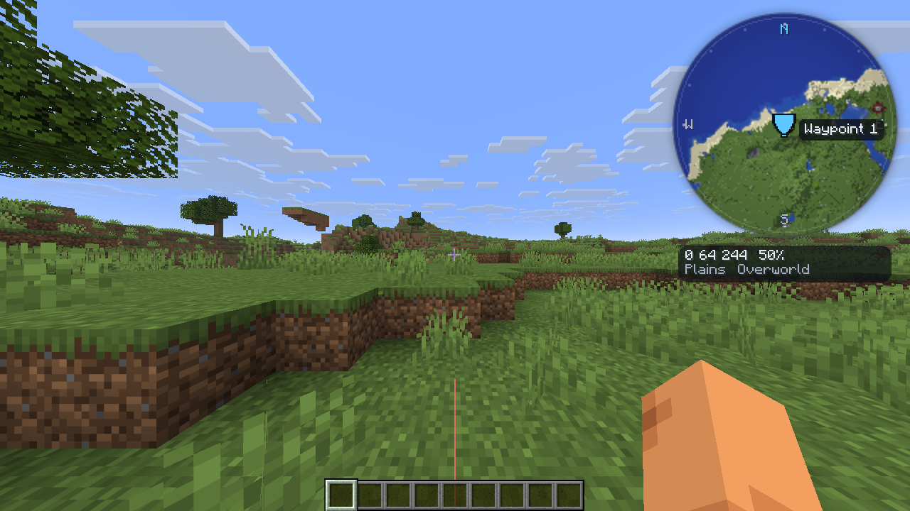
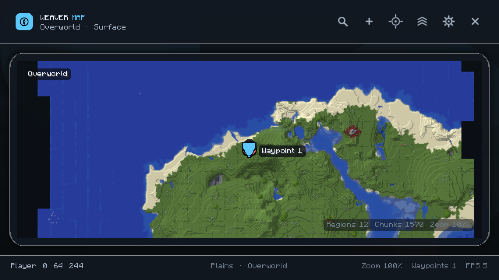

# Weaver Minimap v2

A client-only, dark-glass minimap and fullscreen map built as a real Weaver
mod. It uses the loader's public client hooks only: the injected HUD layer,
screen factories, key mappings, tooltip injection, world render hook, client
chunk events, `DynamicTextureHandle`, and the mod-local `MinimapApi`. The mod
adds no Mixin of its own.



## Features

- **HUD minimap** with a true circular or rounded-glass frame, cached shadow
  and border, north-up or player-up rotation, smooth zoom and yaw, compass ring,
  player arrow, coordinates/biome/dimension/zoom/clock readout, waypoint and
  entity markers, off-screen waypoint arrows, and optional chunk grid, slime
  chunks, world border, and spawn markers.
- **Fullscreen map** with a toolbar, searchable waypoint sidebar, pannable and
  zoomable canvas, layers/cave panel, bottom status bar, right-click context
  menu, draggable waypoints, and a waypoint editor.
- **Cave mode** with real per-Y cave slices, automatic cave-level detection,
  manual Y selection, transparency, and a dimmed surface overlay. Cave palettes
  cover the Overworld, Nether, and End.
- **Waypoints**: names, colours, icons, groups, visibility, temporary expiry,
  automatic death waypoints, import/export (clipboard and file), and local
  per-world/per-dimension persistence.
- **Settings** with ten tabs, live HUD preview, search, reset section/all,
  config import/export, tooltips, sliders, toggles, dropdowns, colour/icon
  pickers, and keybind capture.
- **Themes** in Dark, Light, Midnight Blue, Emerald, Amber, and Custom accent.
- **Public mod API** for map layers, colours, waypoints, entity icons, HUD
  overlays, and map actions.
- **Loader additions** used by this mod: tooltip injection, world render
  (gizmo) hook, client chunk events, key modifiers, and partial/mipmapped
  dynamic textures. All live in `api`/`api-game`/`core` and are documented in
  [docs/client.md](../../docs/client.md).



## Build and run

From this directory:

```powershell
..\..\gradlew.bat clean test weaverBuild weaverStage
.\play.ps1
```

`play.ps1` copies the deterministic fixture world, stages the mod, starts the
client through the Weaver launcher, and leaves the game open. Close the
Minecraft window to stop it.

Screenshots and markers with the deterministic proof:

```powershell
.\play.ps1 -Proof all
```

The proof writes `01-hud.png` through `05-waypoint-editor.png` into
`build/screenshots` and logs the standard markers. Set `WEAVER_GAME_DIR` if the
game is not in `work/game-26.3`.

## Keys

| Key | Action |
|---|---|
| `M` | Open or close the fullscreen map |
| `O` | Open settings |
| `B` | Add a waypoint at the player |
| `H` | Toggle the HUD |
| `J` | Cycle surface / auto cave / manual cave |
| `K` | Toggle entity markers |
| `L` | Toggle waypoint labels |
| `P` | Temporarily hide the HUD (3 s) |
| `N` | Open the fullscreen map focused on waypoints |
| `]` / `[` | Zoom in / out |
| `Home` | Centre the map on the player |
| Arrow keys | Pan the map |
| Mouse wheel | Zoom at the cursor |
| Left drag | Pan the map (or drag a waypoint) |
| Right click | Map context menu |
| Double click | Zoom in at the cursor |

All eleven keybinds are rebindable from the vanilla Controls screen or the
Advanced settings tab.

## Settings

The settings screen has ten sections: General, Appearance, Minimap, Fullscreen
Map, Waypoints, Cave Mode, Entities, Performance, Compatibility, and Advanced.
The right-hand panel renders the real HUD at a preview size and updates while
you change colours, shape, opacity, size, and zoom. Changes save automatically;
`Reset section`, `Reset all`, config import, and config export are in the rail
and Advanced tab.

## Files

- Config: `<config dir>/weaver-minimap/minimap.json`
- Waypoints: `<data dir>/worlds/<world>/waypoints.json`
- Surface regions: `<data dir>/<world>/<dimension>/regions/*.wmap`
- Cave slices: `<data dir>/<world>/<dimension>/caves/*.wslice`
- Proof screenshots: `build/screenshots`
- Proof logs: `build/weaver/logs`

The world key is the single-player level name or the multiplayer server
address. Dimension names are normalised to filesystem-safe names.

## What the loader provides

The mod is a consumer of these public hooks; see
[Client API](../../docs/client.md) for signatures and threading:

- `HudLayer` and `HudRenderContext` with the frame partial tick.
- `WorldRenderRegistry` / `WorldRenderContext` / `WorldRenderSink` for
  world-space waypoint beams.
- `ClientRegistry.registerChunkListener` for chunk load/unload/block updates.
- `TooltipProvider` fed by the built-in `Screen#getTooltipFromItem` hook.
- `DynamicTextureHandle` with linear filtering, partial upload, and mipmaps.
- `KeyMappingSpec.modifiers` enforced by the core key poller.

## Verification

```powershell
..\..\gradlew.bat clean test weaverBuild
```

Unit tests cover projection, region v1/v2 storage, cave slices and auto-Y
scoring, waypoint v1/v2 migration, import/export, config migration/reset,
themes, UI maths, icons, keybind conflicts, and provider isolation.

Client markers:

```text
MINIMAP HUD rendered
TEXTURE ok
SCREEN rendered
SETTINGS rendered
WAYPOINT ok
WAYPOINT EDITOR rendered
WORLD RENDER ok listeners=1
CHUNK EVENTS ok type=load
```

Measured on the fixture client during the first map scan: HUD extraction about
`0.87 ms` per frame at 31 FPS, down from `11.2 ms` before the cached chrome and
throttled compositor; the HUD is idle when the player is stationary and the
map data is not advancing.

The full proof completed on 2026-11-04 at 21:06. Later relaunches of the same
build intermittently hit a native Windows APPCRASH in `jvm.dll`/`ntdll.dll`
before world load with no Minecraft crash report; that is an environment
launch failure, not a mod failure. The proof screenshots and markers above are
from the successful run.

## Deliberate limits

- Client-only. There is no server sync, waypoint sharing, or multi-client
  waypoint protocol in v2. The waypoint JSON keeps an extension map so a future
  sync layer can be added without losing data.
- Cave scanning is client-thread work spread across ticks; disk reads/writes
  are asynchronous. Large cave views fill in progressively.
- Slime chunks require the single-player integrated server seed. The toggle is
  ignored on multiplayer servers without a seed.
- Biome and height map layers are not rendered as separate fullscreen layers in
  this pass; the surface colouring already includes biome tint, and height is
  used for slope shading and cave depth.
- The mod never adds a Mixin, never replaces the vanilla HUD, and never starts a
  second HUD hook.

## Architecture

- `map/` - region model, async storage, chunk/cave scanners, palettes, budgets.
- `render/` - HUD compositor, cached chrome, icon atlas, region/cave textures,
  marker drawing, shared map projection.
- `ui/` - fullscreen map, settings, waypoint editor, import/export, theme and
  widget toolkit.
- `waypoint/` - immutable waypoint model, v2 store, manager, future-sync record.
- `config/` - self-contained JSON config with v1 compatibility and snapshots.
- `input/` - keybind table, GLFW codes, conflict detection.
- `api/` - public `MinimapApi` provider registries.
